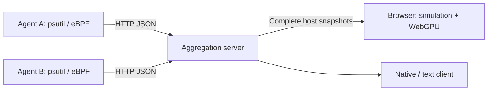

# 🐠 Process Aquarium

[日本語](./README.md) | English

Watch OS processes swim as fish. Run **collection agents**, a **headless aggregation server**, and a **WebGPU browser client** independently. The existing pygame aquarium and standalone local mode remain available.



The server serves telemetry and static assets. Simulation and rendering run in the browser; the server needs no GPU, pygame, or display. Canvas 2D takes over when WebGPU is unavailable or its device is lost. No frontend build or Node.js runtime is required.


Screenshot showing a 24-process validation stream.

## Quick start

Requires Python 3.10+ and [uv](https://docs.astral.sh/uv/).

```bash
git clone https://github.com/mouri-lab/process-aquarium.git
cd process-aquarium
uv sync --locked --no-dev --extra agent

# Terminal 1: aggregation server
./.venv/bin/python main.py server
```

In a second terminal, from the same directory:

```bash
# Terminal 2: collect this host without root
./.venv/bin/python main.py agent --server http://127.0.0.1:8080 --source psutil
```

Open **<http://localhost:8080>**. The aquarium waits for actual telemetry; it does not invent metrics before an agent connects. Stop each process with Ctrl+C.

## Multiple hosts

The aggregation server only needs the Python standard library.

```bash
# Aggregation host
uv sync --locked --no-dev
export AQUARIUM_TOKEN='your-shared-secret'
./.venv/bin/python main.py server --listen 0.0.0.0 --port 8080
```

Install and run an agent on every monitored host. Each `--host-id` must be unique; the default is the hostname.

```bash
uv sync --locked --no-dev --extra agent
export AQUARIUM_TOKEN='your-shared-secret'
./.venv/bin/python main.py agent \
  --server https://aquarium.example.com --host-id worker-01 --source psutil
```

Open the server URL, enter the token through Access, and choose a host. The browser keeps the token in that tab's sessionStorage, never in a URL. Prefer `AQUARIUM_TOKEN` over `--token` so the secret is absent from the monitored process's command line.

Remote WebGPU needs HTTPS; HTTP localhost is supported. Terminate TLS with Caddy, nginx, or another reverse proxy. An ordinary HTTP LAN URL uses Canvas 2D instead. Use HTTPS for authenticated remote connections.

## Reading and navigating the aquarium

| Visual | Meaning |
| --- | --- |
| Color / markings | Process name |
| Size | Memory percentage, logarithmically scaled |
| Glow / swimming speed | CPU usage |
| Orbiting dots | Threads, capped at 12 in the browser |
| Schools | Parent/child and related processes |
| Fade in / out | New processes / actual exits |

- Click a fish or a process row to inspect it.
- Drag to pan and scroll to zoom around the pointer.
- Follow fish tracks the selection; Recenter / R resets the camera.
- Space / Pause stops movement while telemetry continues updating.
- Search by name or PID; sort by CPU, memory, name, or PID; change display limits.
- Hiding a process through filtering does not generate an exit animation.
- Disconnections and collection failures retain the last state with a Stale / Offline indicator, rather than making every fish die.

Total CPU is the sum of process usage, with 100% representing one CPU core. Total memory sums process percentages; it does not deduplicate shared physical pages.

## eBPF on Linux

eBPF captures fork / exec / exit while psutil periodically refreshes metrics and reconciles the complete process state. Unavailable BCC falls back to psutil. Runtime eBPF polling failure also continues with psutil collection.

Ubuntu / Debian example, using the same system Python as BCC:

```bash
sudo apt install python3-bpfcc linux-headers-$(uname -r) python3-venv
uv venv -p /usr/bin/python3 --system-site-packages
uv sync --locked --no-dev --extra agent

# Configure the token in an appropriate root-readable environment if needed.
sudo ./.venv/bin/python main.py agent \
  --server http://127.0.0.1:8080 --source ebpf --host-id linux-01
```

## Native and text clients

```bash
# Existing standalone local aquarium
uv sync --locked --no-dev --extra agent --extra gui
./.venv/bin/python main.py --source psutil --limit 100

# Remote native client needs only the gui extra, not psutil
./.venv/bin/python main.py client --server http://127.0.0.1:8080 --host worker-01

# Remote text client: no optional dependencies
./.venv/bin/python main.py client --server http://127.0.0.1:8080 \
  --host worker-01 --headless --headless-interval 2

# Existing local text mode
./.venv/bin/python main.py --source psutil --headless
```

Native controls retain F / F11 (fullscreen), left click (inspect), right click (follow), drag / scroll (camera), L (limit), S / O (sorting), D / I / T / Q (display modes), and Esc (quit). `--no-gpu` disables native SDL GPU rendering.

Native/text clients require `--host` when multiple hosts exist. A selected host never silently changes during an outage.

## Configuration and API

See `python main.py --help` and each subcommand's `--help` for all options.

| Option | Default |
| --- | --- |
| server `--listen` / `--port` | `127.0.0.1` / `8080` |
| server `--stale-after` | 5 seconds since the last new revision |
| server `--retention` / `--max-hosts` | 3600 seconds / 128 hosts |
| agent `--interval` | 1 second |
| client `--poll-interval` / `--timeout` | 1 second / 3 seconds |
| Browser display limit | 300 fish; up to 10,000, independent of collection |

Environment variables: `AQUARIUM_SERVER`, `AQUARIUM_TOKEN`, `AQUARIUM_HOST_ID` (agent), `AQUARIUM_HOST` (client), and `AQUARIUM_SOURCE`. Native clients also support existing `AQUARIUM_LIMIT`, `AQUARIUM_SORT_BY`, `AQUARIUM_SORT_ORDER`, `AQUARIUM_GPU`, and related settings.

Endpoints: `/api/v1/hosts`, `/api/v1/snapshot?host=worker-01`, and `POST /api/v1/snapshots`. When a token is configured, send `Authorization: Bearer …`. `/healthz` and browser assets are public.

State is held in memory. After a server restart, the next full snapshot from each agent restores it. See [architecture and protocol](./docs/architecture.md) for contracts, limits, and verification notes.

## Development

```bash
uv sync --locked --extra agent --extra gui
uv run --locked --extra agent --extra gui python -m pytest -q

# Node.js 18+, no npm dependencies needed
node --test tests/web/*.test.mjs
```

Tests cover HTTP authentication and validation, multiple hosts, reordered and duplicate revisions, reconnects, PID reuse, filtering, and separate-process startup/shutdown. With pygame installed, native rendering is tested through SDL's dummy driver. Browser verification is documented in [architecture](./docs/architecture.md#検証).

MIT License — [LICENSE](./LICENSE)
