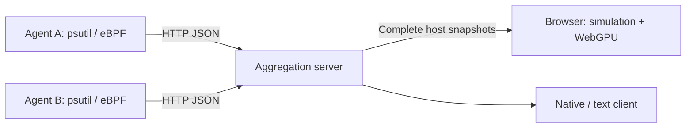
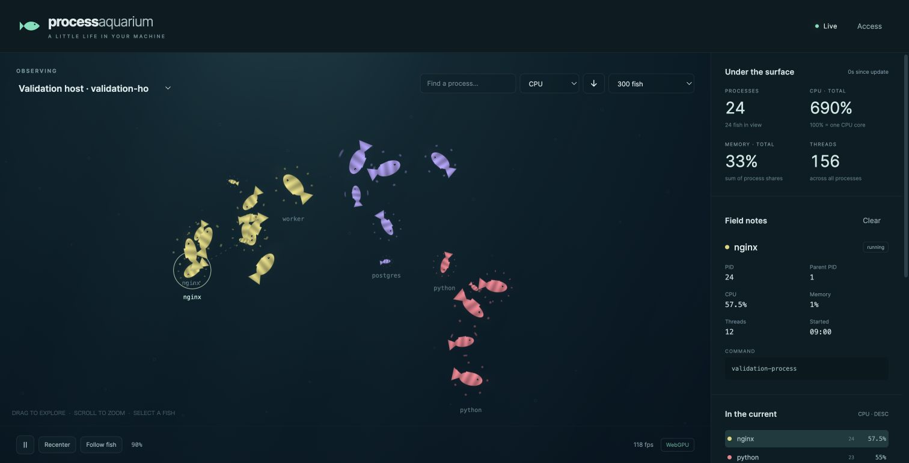

# 🐠 Process Aquarium

[日本語](./README.md) | English

Watch OS processes swim as fish. Run **collection agents**, a **headless aggregation server**, and a **WebGPU browser client** independently. The existing pygame aquarium and standalone local mode remain available.



The server serves telemetry and static assets. Simulation and rendering run in the browser; the server needs no GPU, pygame, or display. Canvas 2D takes over when WebGPU is unavailable or its device is lost. No frontend build or Node.js runtime is required.



Screenshot showing a 24-process validation stream.

## Quick start

Requires Python 3.10+ and [uv](https://docs.astral.sh/uv/).

```bash
git clone https://github.com/mouri-lab/process-aquarium.git
cd process-aquarium
uv sync --locked --no-dev --extra agent

# Terminal 1: aggregation server
./.venv/bin/python main.py server
```

In a second terminal, from the same directory:

```bash
# Terminal 2: collect this host without root
./.venv/bin/python main.py agent --server http://127.0.0.1:8080 --source psutil
```

Open **<http://localhost:8080>**. The aquarium waits for actual telemetry; it does not invent metrics before an agent connects. Stop each process with Ctrl+C.

Measured network traffic gently moves light and floating motes through each tank. The tide settles when traffic stops; `I` toggles it with the existing communication effects. If several network adapters are active, pass `--network-interface en0` (for example, `eth0` on Linux) to the agent, or set `AQUARIUM_NETWORK_INTERFACE`. Automatic selection only runs when one candidate remains after excluding loopback and known virtual adapters. Select one VPN adapter explicitly if needed; physical and virtual counters are never summed. On Linux, BCC also measures per-peer traffic for currents between tanks. See the eBPF setup below.

## Multiple hosts

The aggregation server only needs the Python standard library.

```bash
# Aggregation host
uv sync --locked --no-dev
export AQUARIUM_TOKEN='your-shared-secret'
./.venv/bin/python main.py server --listen 0.0.0.0 --port 8080
```

Install and run an agent on every monitored host. Each `--host-id` must be unique; the default is the hostname.

```bash
uv sync --locked --no-dev --extra agent
export AQUARIUM_TOKEN='your-shared-secret'
./.venv/bin/python main.py agent \
  --server https://aquarium.example.com --host-id worker-01 --source psutil
```

Open the server URL, enter the token through Toolbox → Connection, and choose a host. The browser keeps the token in that tab's sessionStorage, never in a URL. Prefer `AQUARIUM_TOKEN` over `--token` so the secret is absent from the monitored process's command line.

Remote WebGPU needs HTTPS; HTTP localhost is supported. Terminate TLS with Caddy, nginx, or another reverse proxy. An ordinary HTTP LAN URL uses Canvas 2D instead. Use HTTPS for authenticated remote connections.

## Reading and navigating the aquarium

| Visual | Meaning |
| --- | --- |
| Color / markings | Process name |
| Size | Memory percentage, using power/logarithmic scaling |
| Glow / swimming speed | CPU usage |
| Orbiting little fish | Threads, capped at 14 |
| Schools | Parent/child and related processes |
| Growth / shrinking | New processes / actual exits |

The aquarium fills the viewport. Press `Esc` or open the toolbox in the corner to summon a small game window. Drag its title bar to move it; fold it with the minus button or a double-click. The aquarium keeps swimming while windows are open.

- `V` opens the galaxy map of hosts; select a galaxy to enter its aquarium. `[` / `]` switch hosts. Choose each tank’s background in Display; its selection and camera are retained when switching.
- Click a fish to inspect it, or right-click to follow it. `/` searches by name or PID and takes you to the fish.
- Drag to pan; scroll for pointer-centered zoom (0.1–5×). `C` changes camera mode; `R` resets the view.
- `L` cycles display limits. `1`–`6` select 10, 20, 50, 100, 200 or 400 fish; `0` removes the limit. `S` / `O` change sort field/direction.
- `D` toggles parent lines, `I` communication effects and ambient tides, and `Q` school highlighting. Click a chat puff to highlight its communication partners.
- `Space` pauses movement, `T` cycles UI visibility, `F` / `F11` toggles fullscreen, and `?` opens help.
- Swimming defaults to 1× with ¼–1× controls. The 30Hz simulation is interpolated for display; gentle steering and smaller fin strokes soften rapid visual changes.
- Full/reduced/minimal/automatic quality, name labels, hosts, authentication and diagnostics live in the toolbox.
- Display filtering does not imply exits; connection or collection failures retain the last known state.

Seven silhouettes, CPU-dependent glow/speed, family/name schools, fork flashes, exec rainbow changes, memory rings (5%+) and lightning (20%+) are included. See the [native parity audit and comparison images](./docs/feature-parity.md).

Total CPU is the sum of process usage, with 100% representing one CPU core. Total memory sums process percentages; it does not deduplicate shared physical pages.

## eBPF on Linux

eBPF captures fork / exec / exit while psutil periodically refreshes metrics and reconciles the complete process state. Unavailable BCC falls back to psutil. Runtime eBPF polling failure also continues with psutil collection.

Ubuntu / Debian example, using the same system Python as BCC:

```bash
sudo apt install python3-bpfcc linux-headers-$(uname -r) python3-venv
uv venv -p /usr/bin/python3 --system-site-packages
uv sync --locked --no-dev --extra agent

# Configure the token in an appropriate root-readable environment if needed.
sudo ./.venv/bin/python main.py agent \
  --server http://127.0.0.1:8080 --source ebpf --host-id linux-01 \
  --network-interface eth0 --network-peers ebpf --network-scope lab
```

Peer accounting runs inside the existing Python agent, independently of the process source (`--source psutil` also works). `--network-peers auto` attempts Linux/BCC accounting by default; `off` disables it. Missing privileges or BCC leave process and interface telemetry running and report the measurement status. Explicit `ebpf` also reports failures without stopping process collection.

Use the same `--network-scope` for hosts in one routing domain, and different scopes for overlapping networks. NAT mappings are not guessed. Select one inner VPN interface when appropriate. Each direction uses one observer, preferring the sender, so both endpoints are never added together. Volume changes current width and opacity, not speed. See [measurement semantics and validation](./docs/network-currents.md).

## Native and text clients

```bash
# Existing standalone local aquarium
uv sync --locked --no-dev --extra agent --extra gui
./.venv/bin/python main.py --source psutil --limit 100

# Remote native client needs only the gui extra, not psutil
./.venv/bin/python main.py client --server http://127.0.0.1:8080 --host worker-01

# Remote text client: no optional dependencies
./.venv/bin/python main.py client --server http://127.0.0.1:8080 \
  --host worker-01 --headless --headless-interval 2

# Existing local text mode
./.venv/bin/python main.py --source psutil --headless
```

Native controls retain F / F11 (fullscreen), left click (inspect), right click (follow), drag / scroll (camera), L (limit), S / O (sorting), D / I / T / Q (display modes), and Esc (quit). `--no-gpu` disables native SDL GPU rendering.

Native/text clients require `--host` when multiple hosts exist. A selected host never silently changes during an outage.

## Configuration and API

See `python main.py --help` and each subcommand's `--help` for all options.

| Option | Default |
| --- | --- |
| server `--listen` / `--port` | `127.0.0.1` / `8080` |
| server `--stale-after` | 5 seconds since the last new revision |
| server `--retention` / `--max-hosts` | 3600 seconds / 128 hosts |
| agent `--interval` | 1 second |
| client `--poll-interval` / `--timeout` | 1 second / 3 seconds |
| Browser display limit | Unlimited by default (protocol maximum: 50,000); view limits do not affect collection |

Environment variables: `AQUARIUM_SERVER`, `AQUARIUM_TOKEN`, `AQUARIUM_HOST_ID` (agent), `AQUARIUM_HOST` (client), and `AQUARIUM_SOURCE`. Native clients also support existing `AQUARIUM_LIMIT`, `AQUARIUM_SORT_BY`, `AQUARIUM_SORT_ORDER`, `AQUARIUM_GPU`, and related settings.

Endpoints: `/api/v1/hosts`, `/api/v1/snapshot?host=worker-01`, and `POST /api/v1/snapshots`. When a token is configured, send `Authorization: Bearer …`. `/healthz` and browser assets are public.

State is held in memory. After a server restart, the next full snapshot from each agent restores it. See [architecture and protocol](./docs/architecture.md) for contracts, limits, and verification notes.

## Development

```bash
uv sync --locked --extra agent --extra gui
uv run --locked --extra agent --extra gui python -m pytest -q

# Node.js 18+, no npm dependencies needed
node --test tests/web/*.test.mjs
```

Tests cover HTTP authentication and validation, multiple hosts, reordered and duplicate revisions, reconnects, PID reuse, filtering, and separate-process startup/shutdown. With pygame and Node.js installed, differential tests compare the actual native formulas, flocking and drawing primitives. Native rendering also runs through SDL's dummy driver. Browser verification is documented in [architecture](./docs/architecture.md#検証).

MIT License — [LICENSE](./LICENSE)
