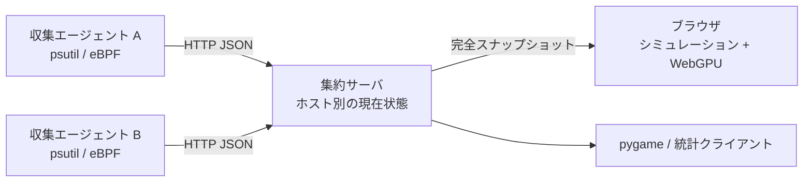

# 🐠 Process Aquarium — プロセス水族館

日本語 | [English](./README.en.md)

OS のプロセスを魚として観察する水族館です。監視対象で動く **収集エージェント**、GUI を必要としない **集約サーバ**、**WebGPU ブラウザクライアント**を独立して動かせます。従来の pygame クライアントとローカル実行も利用できます。



サーバはメトリクスと静的ファイルを配信します。魚の動きと描画はブラウザ内で実行し、サーバに GPU・pygame・ディスプレイは不要です。WebGPU が使えない場合や GPU デバイスを失った場合は Canvas 2D に切り替わります。


検証用の 24 プロセスを表示した画面です。

## 最短で動かす

Python 3.10 以上と [uv](https://docs.astral.sh/uv/) を使用します。ブラウザ側はビルド不要で、Node.js も実行には不要です。

```bash
git clone https://github.com/mouri-lab/process-aquarium.git
cd process-aquarium
uv sync --locked --no-dev --extra agent

# ターミナル 1: 集約サーバ
./.venv/bin/python main.py server
```

別のターミナルから同じディレクトリでエージェントを起動します。

```bash
# ターミナル 2: このマシンを監視（root 不要）
./.venv/bin/python main.py agent --server http://127.0.0.1:8080 --source psutil
```

**<http://localhost:8080>** を開くと魚が表示されます。エージェントが接続するまで架空のメトリクスは表示しません。終了は各ターミナルで Ctrl+C です。

水槽の淡い光と浮遊物には、実測した送受信量に応じてゆっくり潮が生まれます。通信が収まると静まり、`I` で通信表示と一緒に切り替えられます。対象NICが複数ある場合は、agent に `--network-interface en0`（Linuxなら例: `eth0`）を指定してください。自動選択は、loopbackと既知の仮想NICを除いた稼働中の候補が1つの場合だけ行います。VPNを観測する場合も対象を1つ指定し、物理NICと重複して足しません。LinuxではBCCによる相手別の実測通信量で、水槽間にも潮が流れます。接続数から流量を推測しません。導入方法は下の「eBPFを利用する」を参照してください。

## Docker / Dockge で集約・Webサーバを動かす

```bash
cp .env.example .env
docker compose up -d --build
```

`.env` の `DOMAIN` に公開するホスト名を設定してください。
共有の外部Dockerネットワーク `caddy` 上で caddy-docker-proxy と接続し、
ラベルで `.env` に設定したドメインへ公開します。
`caddy.tls: internal` を使用するため、ブラウザ側でCaddyの内部CAを信頼する必要があります。
ホスト上のエージェントの接続先は `http://127.0.0.1:8765` です。
イメージはサーバとWebクライアントを含み、BCC・psutil・GPUは不要です。
eBPFエージェントはホスト上で実行してください。コンテナは非rootで動き、
ヘルスチェックと自動再起動を設定しています。

Dockgeでは、設定済みのstacksディレクトリ内の `process-aquarium/` に
`compose.yaml`、`.env`、`Dockerfile`、`.dockerignore`、`main.py`、`src/`、`web/` を置き、
「Scan Stacks Folder」で取り込みます。更新時はそのディレクトリのソースを更新し、
再ビルド・再作成してください。`process-aquarium:local` はローカルビルド用で、
レジストリからpullするイメージではありません。

ホストへのポート公開はloopbackに限定し、ブラウザはCaddy経由で接続します。
認証が必要な場合はサーバとエージェントに `AQUARIUM_TOKEN` を設定してください。状態はメモリ内に保持され、
再起動後はエージェントの次回送信で復元されるため、データ用ボリュームは不要です。

## 複数マシンで使う

集約サーバには Python 標準ライブラリ以外の依存はありません。

```bash
# 集約マシン
uv sync --locked --no-dev
export AQUARIUM_TOKEN='your-shared-secret'
./.venv/bin/python main.py server --listen 0.0.0.0 --port 8080
```

監視対象ごとにエージェントを動かします。`--host-id` は監視対象間で一意にしてください。省略時はホスト名です。

```bash
# 監視対象マシン
uv sync --locked --no-dev --extra agent
export AQUARIUM_TOKEN='your-shared-secret'
./.venv/bin/python main.py agent \
  --server https://aquarium.example.com --host-id worker-01 --source psutil
```

ブラウザでサーバの URL を開き、道具箱の「接続」からトークンを入力し、ホストを選択します。トークンはタブの sessionStorage に保持し、URL に含めません。コマンドラインでも `--token` を指定できますが、監視対象のコマンドラインに秘密を残さないよう環境変数を推奨します。

リモートの WebGPU には HTTPS が必要です（localhost は HTTP でも利用可能）。Caddy / nginx などで TLS を終端し、集約サーバへ転送してください。HTTP の LAN アドレスで開いた場合も Canvas 2D で操作できます。認証を使うリモート通信では HTTPS を使用してください。

## 魚の読み方・操作

| 表現 | 意味 |
| --- | --- |
| 色・模様 | プロセス名に応じた外見 |
| 大きさ | メモリ使用率（べき乗・対数スケール） |
| 光・速さ | CPU 使用率 |
| 周囲の小魚 | スレッド数（最大14匹） |
| 群れ | 親子関係・関連するプロセス |
| 成長 / 縮小 | 新規プロセス / 実際の終了 |

水槽が画面全体に広がります。操作は `Esc` または左上の道具箱から呼び出します。窓はタイトルバーで移動・折り畳みでき、開いている間も魚は泳ぎ続けます。

- `V` または右上の星図で複数ホストを銀河として眺め、銀河を選ぶと水槽へ入ります。`[` / `]` は前・次の水槽です。道具箱の「表示」で、景色（海藻の森・砂の浅瀬・岩礁）と時間帯（自動・朝・昼・夕方・夜）を水槽ごとに別々に選べます。
- 魚をクリックして詳細、右クリックで追従。`/` で名前・PIDを検索して、その魚へ移動できます。
- ドラッグで移動、ホイールで0.1〜5倍にズーム。`C` でカメラ切替、`R` でリセットします。
- `L` で表示数を順送り。`1`〜`6` は10・20・50・100・200・400匹、`0` は無制限です。`S` / `O` で並び順・昇降順を切り替えます。
- `D` は親子線、`I` は通信のつながりと潮のゆらぎ、`Q` は群れの強調。小さな会話の吹き出しをクリックすると通信相手を強調します。
- `Space` で泳ぎを一時停止。`T` で表示を簡略化、`F` / `F11` で全画面、`?` で操作ガイドを開きます。
- 速度は標準1倍、道具箱で¼〜1倍を選べます。固定30Hzの計算に描画補間と方向転換の平滑化を加え、尾の振幅を抑えています。
- フル・簡易・最小・FPS自動調整の品質設定、プロセス名表示、ホスト切替、認証、診断情報も道具箱にあります。
- 表示制限や検索をプロセス終了と区別し、通信断や収集失敗時にも最後の状態を保持します。

7種類の形状、CPUによる光・速さ、親子・同名の群れ、forkの白い光、execの虹色変化、メモリ5%以上の波紋・20%以上の雷を実装しています。対応表と比較画像は[ネイティブ版との比較](./docs/feature-parity.md)にまとめています。

CPU はプロセスごとの値を合計し、100% が 1 コア分です。メモリの合計はプロセス別使用率の和であり、共有ページの重複を除いた物理メモリ使用量ではありません。

## eBPF を利用する（Linux）

eBPF は fork / exec / exit を取得し、CPU・メモリなどの定期更新と状態の再照合には psutil を使用します。BCC が利用できない場合は psutil にフォールバックし、実行中に eBPF の読み取りが失敗した場合も psutil の収集を継続します。

Ubuntu / Debian の例です。BCC と同じシステム Python を使ってください。

```bash
sudo apt install python3-bpfcc linux-headers-$(uname -r) python3-venv
uv venv -p /usr/bin/python3 --system-site-packages
uv sync --locked --no-dev --extra agent

# トークンを使う場合は root から読める適切な環境設定を別途用意
sudo ./.venv/bin/python main.py agent \
  --server http://127.0.0.1:8080 --source ebpf --host-id linux-01 \
  --network-interface eth0 --network-peers ebpf --network-scope lab
```

相手別計測は既存Pythonエージェント内の独立したBCC収集器です。`--source psutil` でも利用でき、`--network-peers off` で停止できます。既定の `auto` はLinuxで計測を試み、権限・BCCが不足する場合もプロセスとNIC全体の収集を続けます。`ebpf` 指定時も失敗状態をテレメトリに残して収集を続けます。

通信する水槽は同じ集約サーバへ登録し、同じルーティング範囲には同じ `--network-scope` を指定します。別ネットワークでIPが重複する場合は異なるscopeに分けてください。NAT越しの対応は推測しません。VPNは内側のNICを1つ選びます。両端の観測は二重加算せず、速度を上げずに潮の幅と濃さへ反映します。詳しい計測範囲・制限・検証方法は[水流の設計](./docs/network-currents.md)に記載しています。

## ネイティブ・統計クライアント

### eBPFエージェントをsystemdで常駐させる

このチェックアウトを `/home/ubuntu/process-aquarium` に配置し、上記のeBPF依存環境を
準備した後、手動起動中のエージェントを停止して実行します。

```bash
sudo ./tools/install-agent-service.sh
```

OS起動時に自動開始し、終了時は5秒後に再起動します。
接続先とNICは `/etc/default/process-aquarium-agent` で設定できます。
ログは `sudo journalctl -u process-aquarium-agent -f`、
停止は `sudo systemctl stop process-aquarium-agent` です。

```bash
# 従来のローカル水族館
uv sync --locked --no-dev --extra agent --extra gui
./.venv/bin/python main.py --source psutil --limit 100

# リモート水族館: 収集用の psutil は不要（gui 追加依存のみ）
./.venv/bin/python main.py client --server http://127.0.0.1:8080 --host worker-01

# GUI 依存が不要なリモート統計表示
./.venv/bin/python main.py client --server http://127.0.0.1:8080 \
  --host worker-01 --headless --headless-interval 2

# 従来のローカル統計表示
./.venv/bin/python main.py --source psutil --headless
```

ネイティブ版は F / F11（全画面）、左クリック（選択）、右クリック（追従）、ドラッグ・ホイール（カメラ）、L（件数）、S / O（ソート）、D / I / T / Q（表示切替）、Esc（終了）を維持しています。`--no-gpu` で SDL GPU 描画を無効化できます。

複数ホストがある場合、ネイティブ・統計クライアントでは `--host` を指定します。一度選択したホストが切断しても、別ホストへ自動で切り替わりません。

## 設定・API

`python main.py --help` と各サブコマンドの `--help` で全オプションを確認できます。

| 設定 | 既定値 |
| --- | --- |
| server `--listen` / `--port` | `127.0.0.1` / `8080` |
| server `--stale-after` | 最後の新しい状態から 5 秒 |
| server `--retention` / `--max-hosts` | 3600 秒 / 128 ホスト |
| agent `--interval` | 1 秒 |
| agent `--network-interface` / `AQUARIUM_NETWORK_INTERFACE` | 候補が1つなら自動選択。複数なら明示指定 |
| agent `--network-peers` / `AQUARIUM_NETWORK_PEERS` | `auto`（Linux/BCC）。`ebpf` / `off` も指定可 |
| agent `--network-scope` / `AQUARIUM_NETWORK_SCOPE` | `default`。同じIP空間を共有するホストの識別範囲 |
| client `--poll-interval` / `--timeout` | 1 秒 / 3 秒 |
| ブラウザ表示件数 | 無制限（プロトコル上限50,000件）。表示制限は収集対象に影響しません |

環境変数は `AQUARIUM_SERVER`、`AQUARIUM_TOKEN`、`AQUARIUM_HOST_ID`（agent）、`AQUARIUM_HOST`（client）、`AQUARIUM_SOURCE` を利用できます。ネイティブ版は既存の `AQUARIUM_LIMIT`、`AQUARIUM_SORT_BY`、`AQUARIUM_SORT_ORDER`、`AQUARIUM_GPU` なども使用します。

API は `/api/v1/hosts`、`/api/v1/snapshot?host=worker-01`、`POST /api/v1/snapshots` です。トークン設定時は `Authorization: Bearer …` が必要です。`/healthz` とブラウザの静的ファイルは認証なしで取得できます。

状態はメモリ内に保持します。サーバを再起動すると保持状態は消え、エージェントが送信する次の完全スナップショットで復元します。詳細な契約・制限は [アーキテクチャ](./docs/architecture.md) を参照してください。

## 開発・テスト

```bash
uv sync --locked --extra agent --extra gui
uv run --locked --extra agent --extra gui python -m pytest -q

# Node.js 18 以上。ブラウザモデルのテストのみで、依存インストールは不要
node --test tests/web/*.test.mjs
```

HTTP の認証・検証、複数ホスト、順序逆転・再送、切断と復旧、PID 再利用、表示フィルタ、別プロセスの起動・停止を検証します。pygame と Node.js がある場合は、実際のネイティブ実装と数式・群れ演算・描画プリミティブを差分検証します。SDL ダミードライバによる描画テストも含みます。実ブラウザでの確認手順は [アーキテクチャ](./docs/architecture.md#検証) に記載しています。

MIT License — [LICENSE](./LICENSE)

### PWA としてインストール

Web クライアントはビルド不要で、既存の Python サーバから Manifest・アイコン・
Service Worker を配信します。`http://localhost:8080/`、または HTTPS で開き、
対応ブラウザの「アプリをインストール」を選択してください。iPhone / iPad では
Safari の共有メニューから「ホーム画面に追加」を選択します。
別端末からアクセスする場合は HTTPS を終端するリバースプロキシを使い、同じ
オリジンのルート `/` に静的ファイルと `/api/` を配信してください。
LAN の IP アドレスに対する通常の HTTP では Service Worker は登録されません。
通常のブラウザ利用は引き続き可能です。インストール方法・対応状況はブラウザに依存します。

初回のオンライン読み込み後、画面の静的リソースだけを端末にキャッシュします。
監視 API（ホスト一覧、スナップショット、フロー、転送）や認証情報は保存しません。
通信断時に既存の魚が残る場合は最後に受信した状態として警告し、プロセス終了は
推測しません。オフラインで再起動しても過去の監視情報は復元されません。
接続復帰後は通常のポーリングで更新します。認証とホスト選択は従来どおりで、
新しいアプリウィンドウではトークンの再入力が必要な場合があります。

静的ファイル変更時は `web/sw.js` の `CACHE_NAME` のバージョンを更新してください。
更新版は全ファイルの取得に成功してから待機し、既存のアプリウィンドウとタブを
すべて閉じた後の起動で有効になります。削除対象は本アプリの旧キャッシュだけです。
配信確認はブラウザ開発者ツールの Application（Manifest / Service Workers /
Cache Storage）から行えます。API を一度使った後にも静的ファイル以外が
Cache Storage に入らないこと、Offline にして再読み込みしても監視データを
現在の値として表示しないことを確認してください。
