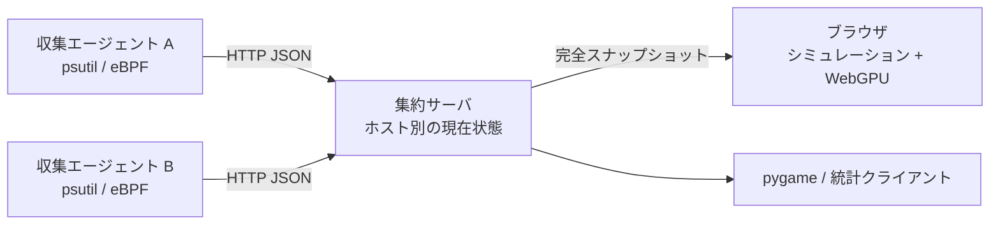

# 🐠 Process Aquarium — プロセス水族館

日本語 | [English](./README.en.md)

OS のプロセスを魚として観察する水族館です。監視対象で動く **収集エージェント**、GUI を必要としない **集約サーバ**、**WebGPU ブラウザクライアント**を独立して動かせます。従来の pygame クライアントとローカル実行も利用できます。



サーバはメトリクスと静的ファイルを配信します。魚の動きと描画はブラウザ内で実行し、サーバに GPU・pygame・ディスプレイは不要です。WebGPU が使えない場合や GPU デバイスを失った場合は Canvas 2D に切り替わります。


検証用の 24 プロセスを表示した画面です。

## 最短で動かす

Python 3.10 以上と [uv](https://docs.astral.sh/uv/) を使用します。ブラウザ側はビルド不要で、Node.js も実行には不要です。

```bash
git clone https://github.com/mouri-lab/process-aquarium.git
cd process-aquarium
uv sync --locked --no-dev --extra agent

# ターミナル 1: 集約サーバ
./.venv/bin/python main.py server
```

別のターミナルから同じディレクトリでエージェントを起動します。

```bash
# ターミナル 2: このマシンを監視（root 不要）
./.venv/bin/python main.py agent --server http://127.0.0.1:8080 --source psutil
```

**<http://localhost:8080>** を開くと魚が表示されます。エージェントが接続するまで架空のメトリクスは表示しません。終了は各ターミナルで Ctrl+C です。

## 複数マシンで使う

集約サーバには Python 標準ライブラリ以外の依存はありません。

```bash
# 集約マシン
uv sync --locked --no-dev
export AQUARIUM_TOKEN='your-shared-secret'
./.venv/bin/python main.py server --listen 0.0.0.0 --port 8080
```

監視対象ごとにエージェントを動かします。`--host-id` は監視対象間で一意にしてください。省略時はホスト名です。

```bash
# 監視対象マシン
uv sync --locked --no-dev --extra agent
export AQUARIUM_TOKEN='your-shared-secret'
./.venv/bin/python main.py agent \
  --server https://aquarium.example.com --host-id worker-01 --source psutil
```

ブラウザでサーバの URL を開き、Access からトークンを入力し、ホストを選択します。トークンはタブの sessionStorage に保持し、URL に含めません。コマンドラインでも `--token` を指定できますが、監視対象のコマンドラインに秘密を残さないよう環境変数を推奨します。

リモートの WebGPU には HTTPS が必要です（localhost は HTTP でも利用可能）。Caddy / nginx などで TLS を終端し、集約サーバへ転送してください。HTTP の LAN アドレスで開いた場合も Canvas 2D で操作できます。認証を使うリモート通信では HTTPS を使用してください。

## 魚の読み方・操作

| 表現 | 意味 |
| --- | --- |
| 色・模様 | プロセス名に応じた外見 |
| 大きさ | メモリ使用率（対数スケール） |
| 光・速さ | CPU 使用率 |
| 周囲の点 | スレッド数（ブラウザでは最大 12 個） |
| 群れ | 親子関係・関連するプロセス |
| フェードイン / アウト | 新規プロセス / 実際の終了 |

- 魚または右側のプロセス一覧をクリックすると詳細を表示します。
- ドラッグでパン、ホイールでポインタ位置を中心にズームします。
- Follow fish で選択した魚を追従、Recenter / R で視点を戻します。
- Space / 一時停止ボタンは魚の動きだけを止め、メトリクス取得は継続します。
- 検索、CPU・メモリ・名前・PID のソート、表示件数の変更が可能です。
- 表示対象から外れたプロセスと、実際に終了したプロセスは区別します。
- 通信断・収集失敗時は最後の状態を残して Stale / Offline を表示し、一斉終了のアニメーションは流しません。

CPU はプロセスごとの値を合計し、100% が 1 コア分です。メモリの合計はプロセス別使用率の和であり、共有ページの重複を除いた物理メモリ使用量ではありません。

## eBPF を利用する（Linux）

eBPF は fork / exec / exit を取得し、CPU・メモリなどの定期更新と状態の再照合には psutil を使用します。BCC が利用できない場合は psutil にフォールバックし、実行中に eBPF の読み取りが失敗した場合も psutil の収集を継続します。

Ubuntu / Debian の例です。BCC と同じシステム Python を使ってください。

```bash
sudo apt install python3-bpfcc linux-headers-$(uname -r) python3-venv
uv venv -p /usr/bin/python3 --system-site-packages
uv sync --locked --no-dev --extra agent

# トークンを使う場合は root から読める適切な環境設定を別途用意
sudo ./.venv/bin/python main.py agent \
  --server http://127.0.0.1:8080 --source ebpf --host-id linux-01
```

## ネイティブ・統計クライアント

```bash
# 従来のローカル水族館
uv sync --locked --no-dev --extra agent --extra gui
./.venv/bin/python main.py --source psutil --limit 100

# リモート水族館: 収集用の psutil は不要（gui 追加依存のみ）
./.venv/bin/python main.py client --server http://127.0.0.1:8080 --host worker-01

# GUI 依存が不要なリモート統計表示
./.venv/bin/python main.py client --server http://127.0.0.1:8080 \
  --host worker-01 --headless --headless-interval 2

# 従来のローカル統計表示
./.venv/bin/python main.py --source psutil --headless
```

ネイティブ版は F / F11（全画面）、左クリック（選択）、右クリック（追従）、ドラッグ・ホイール（カメラ）、L（件数）、S / O（ソート）、D / I / T / Q（表示切替）、Esc（終了）を維持しています。`--no-gpu` で SDL GPU 描画を無効化できます。

複数ホストがある場合、ネイティブ・統計クライアントでは `--host` を指定します。一度選択したホストが切断しても、別ホストへ自動で切り替わりません。

## 設定・API

`python main.py --help` と各サブコマンドの `--help` で全オプションを確認できます。

| 設定 | 既定値 |
| --- | --- |
| server `--listen` / `--port` | `127.0.0.1` / `8080` |
| server `--stale-after` | 最後の新しい状態から 5 秒 |
| server `--retention` / `--max-hosts` | 3600 秒 / 128 ホスト |
| agent `--interval` | 1 秒 |
| client `--poll-interval` / `--timeout` | 1 秒 / 3 秒 |
| ブラウザ表示件数 | 300 匹、最大 10,000 匹（収集対象の制限ではありません） |

環境変数は `AQUARIUM_SERVER`、`AQUARIUM_TOKEN`、`AQUARIUM_HOST_ID`（agent）、`AQUARIUM_HOST`（client）、`AQUARIUM_SOURCE` を利用できます。ネイティブ版は既存の `AQUARIUM_LIMIT`、`AQUARIUM_SORT_BY`、`AQUARIUM_SORT_ORDER`、`AQUARIUM_GPU` なども使用します。

API は `/api/v1/hosts`、`/api/v1/snapshot?host=worker-01`、`POST /api/v1/snapshots` です。トークン設定時は `Authorization: Bearer …` が必要です。`/healthz` とブラウザの静的ファイルは認証なしで取得できます。

状態はメモリ内に保持します。サーバを再起動すると保持状態は消え、エージェントが送信する次の完全スナップショットで復元します。詳細な契約・制限は [アーキテクチャ](./docs/architecture.md) を参照してください。

## 開発・テスト

```bash
uv sync --locked --extra agent --extra gui
uv run --locked --extra agent --extra gui python -m pytest -q

# Node.js 18 以上。ブラウザモデルのテストのみで、依存インストールは不要
node --test tests/web/*.test.mjs
```

HTTP の認証・検証、複数ホスト、順序逆転・再送、切断と復旧、PID 再利用、表示フィルタ、別プロセスの起動・停止を検証します。pygame がある場合は SDL ダミードライバでネイティブ描画もテストします。実ブラウザでの確認手順は [アーキテクチャ](./docs/architecture.md#検証) に記載しています。

MIT License — [LICENSE](./LICENSE)
