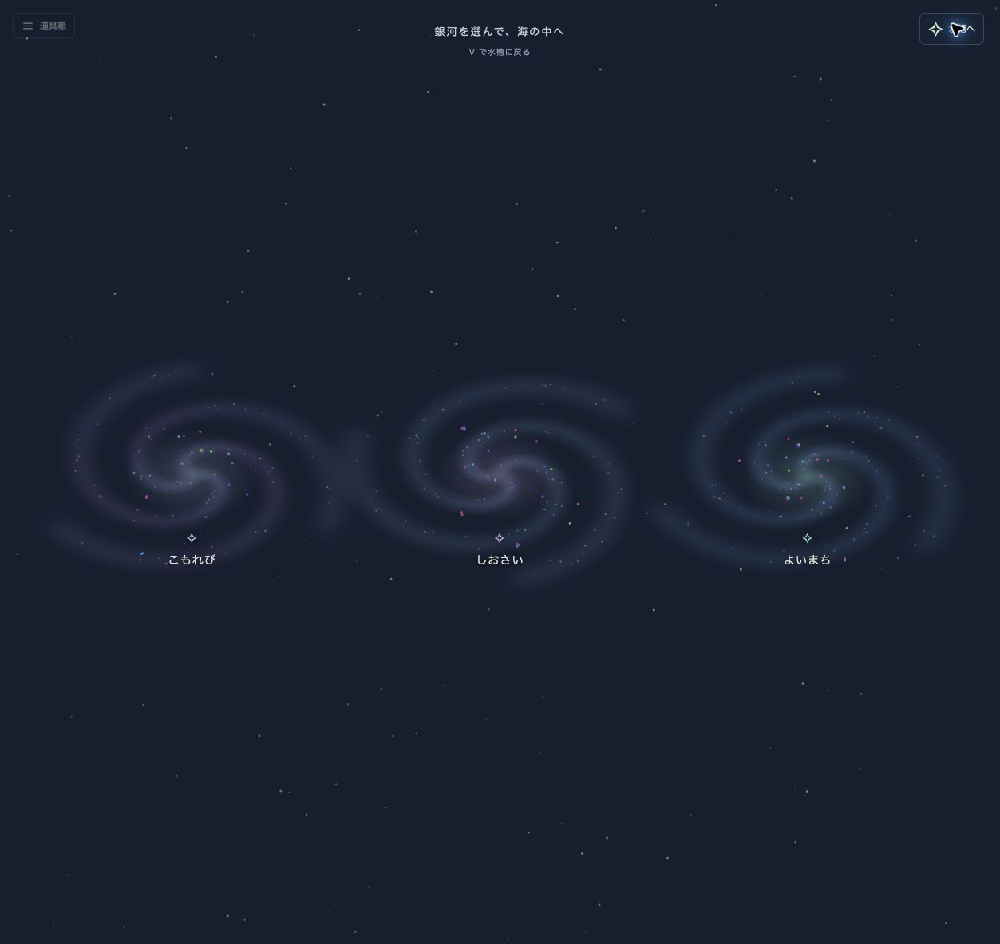

# 収集・集約・描画の境界

Issue #11 の分離を、既存のローカル実行を維持しながら実装しています。描画方式はブラウザ上の WebGPU を主経路とし、サーバは描画を実行しません。

## 構成

| モジュール | 責務・依存 |
| --- | --- |
| `src/telemetry.py` | GUI に依存しないデータ型、schema version 1、検証・JSON 変換 |
| `src/core/source.py` | 完全スナップショットと取得状態を渡すインターフェース |
| `src/core/sources.py` | psutil / BCC によるローカル収集。psutil は agent 追加依存 |
| `src/agent.py` | 最新状態の送信、切断時の再試行 |
| `src/server.py` | ホスト別の現在状態、受信順序・再送の検証、HTTP API・静的ファイル配信 |
| `src/remote.py` | バックグラウンドでの HTTP 取得。閲覧端末の OS は調査しない |
| `src/presentation.py` | ネイティブ・テキスト向けの選択・ソート・関係の解釈 |
| `web/world.mjs` | ブラウザ内の魚の状態・表示選択・群れのシミュレーション |
| `web/fish.mjs` / `web/geometry.mjs` | ネイティブ相当の数式・挙動・共有図形 |
| `web/effects.mjs` | 背景、水中光、通信、波紋、吹き出し |
| `web/menu.mjs` / `web/controls.mjs` | 移動・折り畳み可能な窓、ショートカット、カメラ・表示設定 |
| `web/renderer.mjs` | インスタンス描画の WebGPU パイプライン、Canvas 2D への切替 |
| `web/app.mjs` | 認証、ホスト選択、取得、カメラ、詳細 UI |
| `src/visuals/` | 既存 pygame の描画・アニメーション |
| `main.py` | 起動設定とリソースの所有。各実行モードに必要な依存だけを読み込む |

魚の座標、選択状態、フェード、群れ、カメラ、表示件数はクライアントに属します。エージェントと集約サーバにはこれらを送信しません。ブラウザのシミュレーションは JavaScript で実行し、WebGPU は描画を担当します。GPU デバイスの取得失敗・喪失時も同じシミュレーションで Canvas 2D に切り替えます。

シミュレーションは固定30Hzで計算し、描画用状態だけをフレームごとに補間します。短い方向転換は描画時に平滑化し、尾の振れを小さな連続波に置き換えます。クリック判定・追従カメラ・通信線も同じ描画位置を使います。標準は1倍速で、¼〜1倍への変更と一時停止は収集周期に影響しません。

独立したレンダリングサーバでの動画生成は、この WebGPU 構成には含めていません。ブラウザ自身が描画クライアントとなります。

## スナップショット契約

`Snapshot` は次の項目を持ちます。

| 項目 | 意味 |
| --- | --- |
| `schema_version` | 現在は整数 `1`。不一致は拒否 |
| `host_id` / `hostname` | 設定した識別子 / 表示用ホスト名 |
| `boot_id` | OS 起動セッション。Linux では kernel boot ID、その他では起動時刻 |
| `session_id` | エージェントの起動ごとに生成する UUID |
| `sequence` | そのエージェント内で単調増加するスナップショット番号 |
| `collected_at` | 最後の収集時刻（Unix 秒）。クライアントのアニメーション時計には使わない |
| `source` | 実際に収集している `psutil` / `eBPF` |
| `processes` | そのホストの完全な現在状態。表示フィルタは適用しない |
| `events` | 最大 2048 件のライフサイクルイベント再生窓 |
| `connections` | 収集対象内で観測した関係 |
| `network_flows` | 任意項目。最大4096件のソケット端点観測。通信量や送受信イベントではない |
| `event_stats` / `error` | イベント集計 / 収集失敗の理由 |

プロセスの識別は `(host_id, boot_id, pid, create_time)` です。PID が再利用された場合やホストが再起動した場合に、以前の魚と同一視しません。`ProcessRecord` に `is_new` や `is_dying` などの表示状態はありません。

ホスト ID・起動 ID・エージェント ID は最大 128 文字、プロセスは最大 50,000 件、アップロードは最大 16 MiB です。整数は JavaScript と共有できる範囲、浮動小数点数は有限値に制限し、重複 PID、不正なイベント番号、過剰に深い metadata などを拒否します。

## 順序・イベント・再接続

- 同一セッションの新しい `sequence` のみ状態を置き換えます。
- 同一内容の同一番号を再送した場合は成功として扱い、受信時刻は更新しません。古いデータの再送で正常状態が装われることを防ぎます。
- 別内容の同一番号や番号の逆転は HTTP 409 です。
- 新しいエージェントセッションが受理された後、置き換えられたセッションからの送信は拒否します。ホストごとの退役セッション履歴は最大 256 件です。
- 各クライアントが `(session_id, event_id)` のカーソルを保持します。一方のクライアントがイベントを読んでも、他方から消えることはありません。
- 再生窓からイベントが落ちた場合は欠落数を通知し、完全スナップショットから現在状態を再構成します。短命プロセスのすべての履歴を保存する保証はありません。
- エージェントは切断中に過去のスナップショットを無制限に積みません。最新の完全状態と有限のイベント窓を再送します。
- 認証失敗・schema 不一致・退役セッションなどの再試行で直らない拒否では、エージェントはエラー終了します。

## 欠測と終了

サーバは受信側の monotonic clock を使って freshness を判定し、エージェントとサーバの時計ずれに依存しません。既定で 5 秒間新しい状態が届かなければ Stale、3600 秒でホストを保持領域から削除します。ホスト数は既定で最大 128 件です。上限では新規ホストを HTTP 503 で拒否し、既存状態を守ります。

通信断や収集失敗は「プロセスが空になった」と解釈しません。ブラウザとリモートソースは最後の正常な状態を保持し、Stale / Offline を表示します。保持期限による 404 でも、クライアント内の最後の状態は勝手に消しません。

クライアントは完全状態を比較してから表示を絞ります。フィルタで非表示になった魚は終了扱いにせず、完全状態から消えた魚だけをフェードアウトさせます。

## 収集

psutil はバックグラウンドでプロセスを定期収集します。PID の追加・消失・生成時刻の変化・実行ファイルの変化を照合し、同じ契約のイベントを生成します。

eBPF は BCC の fork / exec / exit と psutil の定期照合を組み合わせます。初期スキャンだけで止まらず、既存プロセスの CPU・メモリも更新します。thread leader 以外の終了をプロセス終了と誤認しないようにし、perf buffer の欠落数も集計します。イベント読み取りに失敗した場合は psutil を継続します。

IPC はエージェント側でローカル TCP の両端（IP・ポート）、Unix socket のパス、`lsof` が返す pipe/socket の資源識別子を照合し、親子関係とともに送ります。OS・権限に応じた best effort で、`lsof` は10秒キャッシュ・2秒タイムアウト・2MiB出力上限を持ちます。PID再利用時に古い照合結果を引き継ぎません。リモートクライアントは、観測値が空でも自身の端末で `lsof` や psutil を実行しません。共有メモリ検出は元のネイティブ版も未実装です。

## HTTP と運用

| API | 内容 |
| --- | --- |
| `GET /healthz` | 生存確認（認証不要） |
| `GET /api/v1/hosts` | ホスト一覧・freshness・件数 |
| `GET /api/v1/snapshot?host=...` | 完全状態と freshness の envelope |
| `GET /api/v1/flows` | ホストをまたぐソケット端点の照合結果。転送量は含まない |
| `POST /api/v1/snapshots` | 検証済み完全状態の受信 |

トークン設定時はメトリクス API の読み書き両方に Bearer 認証を要求します。静的ファイルは固定の許可リストのみを公開し、任意のファイルやディレクトリは配信しません。HTTP クライアントは認証情報を付けたままリダイレクトを追いません。

プロセスのコマンドラインを含むため、リモートでは HTTPS とトークンを組み合わせてください。例えば Caddy の次の設定で TLS を終端できます。集約サーバは通常の `--listen 127.0.0.1 --port 8080` で起動します。

```caddyfile
aquarium.example.com {
    reverse_proxy 127.0.0.1:8080
}
```

このサーバは履歴 DB やユーザー別権限を持ちません。同じトークンを持つクライアントは全ホストのメトリクスを読めます。複数のエージェントで同じ `host_id` を共有せず、各ホストに一意の ID を割り当ててください。

## 検証

Python テストはデータ契約・収集・集約 API・順序逆転・再送・認証・複数ホスト・通信断と復帰・PID 再利用・表示制限・別プロセス起動と停止を検証します。GUI 依存を禁止したリモート CLI、OS 収集依存を禁止したリモート CLI、SDL ダミードライバでのネイティブ描画も含みます。

Node.js のテストはブラウザモデル単体で動き、PID 再利用、イベント再生、欠測、ホスト切替、フィルタ、30/60/120Hzの挙動、描画補間、方向転換の平滑化、ショートカット、吹き出しの重なり回避、窓の画面内への制限を検証します。Python側の差分テストは、実際のpygame実装とブラウザの数式・図形・群れ演算を比較します。詳細は[対応表](./feature-parity.md)を参照してください。

実ブラウザでは以下を確認してください。

1. `server` と psutil の `agent` を起動し、WebGPU の表示とコンソールエラーがないことを確認する。
2. 検索、ソート、件数、魚の選択、詳細、追従、パン、ズーム、一時停止を操作する。
3. 同じ PID を含む 2 ホストを切り替え、前の選択が引き継がれないことを確認する。
4. 送信を止め、魚が一斉終了せず Stale になり、送信再開で Live に戻ることを確認する。
5. `?renderer=canvas` を指定し、代替描画と操作を確認する。
6. 小さい表示幅で横方向のはみ出しがないこと、窓の移動・折り畳み・再表示、検索中のEsc、数字キーとLによる件数変更を確認する。
7. トークンありのサーバで、拒否・接続成功・トークン削除を確認する。

Linux カーネルへの BCC アタッチは実機で別途確認が必要です。自動テストでは hybrid の定期メトリクス更新、PID 照合、取得失敗時の状態保持を検証し、BCC が存在しない環境でも実行できます。

## 複数水槽と背景（#15、#13 / #14 の準備）

`web/multiverse.mjs` の Tank は集約先と host_id で識別し、魚・選択・フィルタ・カメラ・欠測状態を個別に保持します。星図は最大6水槽を同時に描画し、取得は最大3リクエスト並列です。画面外の水槽はシミュレーションを停止し、戻ったときに完全状態を取得します。カタログは128ホストまで、保持状態は離脱した選択中ホストのための1枠を含め最大129件です。通信失敗を隣の水槽へ波及させず、遅れて届いた応答で選択中ホストを切り替えません。

`V` で星図、銀河のクリックで水槽へ入り、`[` / `]` で前後の水槽に移動します。WebGPU は1デバイスで各水槽のカメラと描画範囲を切り替え、Canvas 2D も同じ図形を使用します。遠くの小さな魚は色の光として描きます。動きを減らす設定では接近演出を即時切替にします。

背景は `web/backgrounds.mjs` の provider が担当します。現在は3種類の固定パレットを水槽ごとに選択し、集約先・ホスト別にブラウザへ保存します。接近時も同じ provider を使い、画面全体を覆う背景に柔らかなマスクを掛けることで四角い端が出ないようにしています。動的背景・時刻による変化は今回の範囲外です。provider にアニメーション時刻と実時刻を別々に渡す境界を残しています。

## 水槽間の通信（#16 の設計準備）

将来の通信グラフは Tank の外に置き、端点を `{tank, boot, pid, started}` で参照します。`tank` は集約先と host_id、`started` は create_time です。`processRef` / `resolve` はホスト間の同一PID、PID再利用、再起動を区別し、現在の状態に存在しない端点は解決しません。表示数制限で非表示のプロセスと、実際に存在しないプロセスも区別します。

現在の `Connection(pid_a, pid_b, kind)` は同一ホスト内の関係です。これを別ホストのPIDへ結び付けることはしません。追加した任意項目 `network_flows` と `/api/v1/flows` はソケット端点を収集・照合する基礎部分です。既存エージェントから項目が届かなくても受理します。端点の一致や listener は、直近のデータ転送の証拠にはなりません。API の `direction` も端点照合の向きであり、実測した送受信方向ではありません。NAT・重複したプライベートアドレス・観測時刻のずれを含む経路確定は未対応です。

魚同士を線と粒で結ぶ水流の試作は撤去しました。ブラウザは `/api/v1/flows` を取得せず、端点観測による追加描画や件数表示をしません。既存のバブルはプロセス間の関係の演出として維持します。バブルもパケット単位の実測表示ではありません。#16 の水流は未完成です。次の実装の役割・データ契約・受け入れ条件は[水流の設計](./network-currents.md)に記載します。

検証（2026-10-23）: Python 80件、Node 34件成功。3水槽のWebGPU、8水槽のCanvas、ページ送り、1ホストの欠測、390px幅、背景切替と選択保持をブラウザで確認しました。再現用の合成データは `python tools/demo_multiverse.py --hosts 8 --stale-last` でローカルの8765番サーバへ送れます。実プロセス情報は収集しません。


