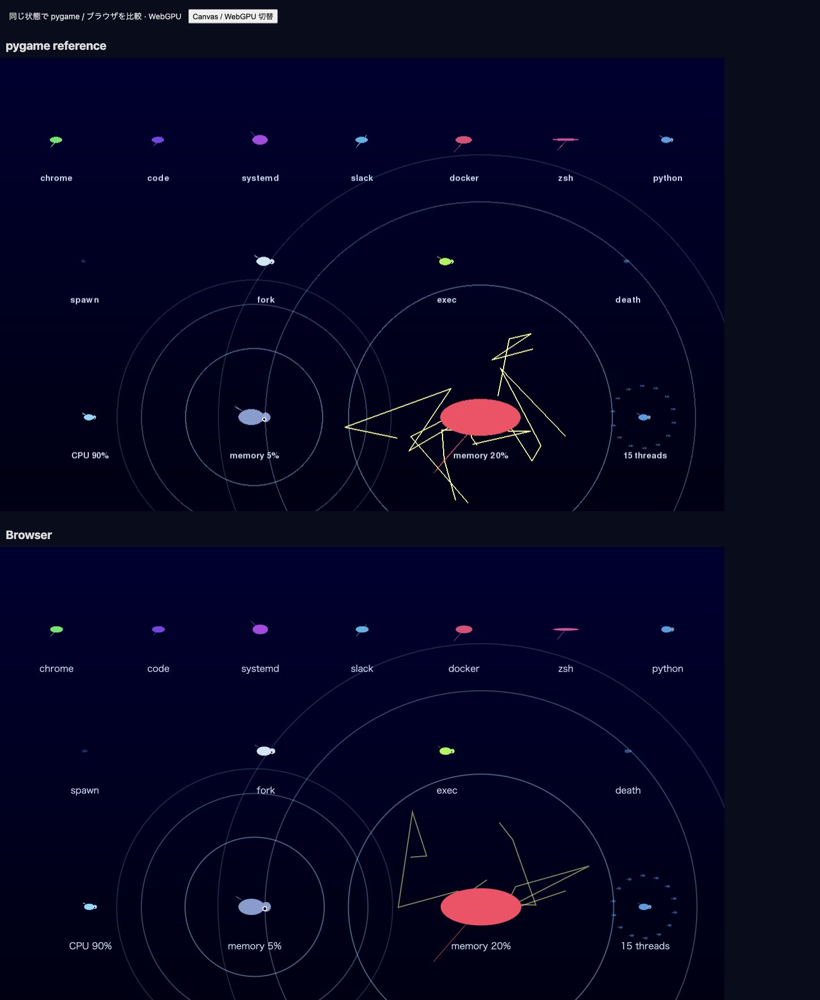
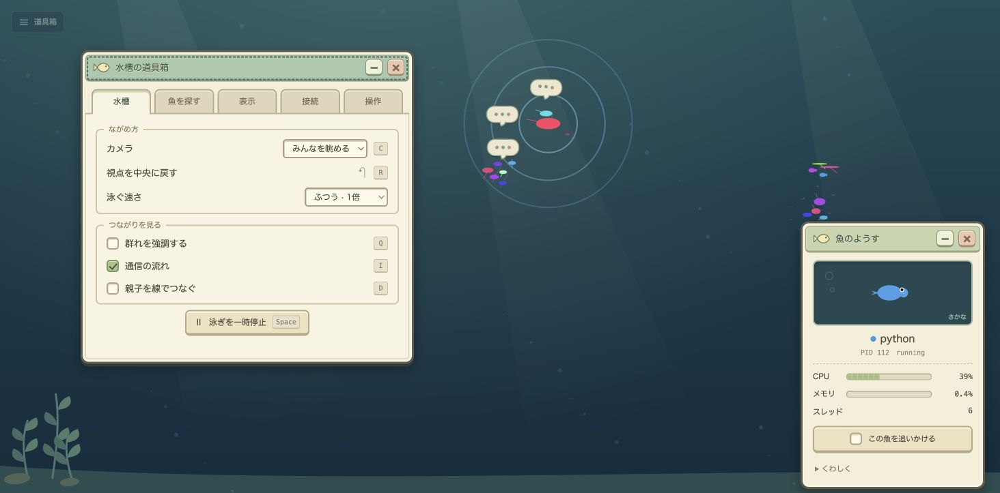

# Native → browser feature audit

Reference: `src/visuals/fish.py`, `src/visuals/aquarium.py`, and the original
collector in commit `3e98f97`. The distributed transport is retained. Visual
state and camera state belong exclusively to each client.

| Native behavior | Browser implementation / verification |
| --- | --- |
| Seven process-name silhouettes; HSV name colors | Shared Canvas/WebGPU geometry; native differential tests |
| Exponential memory size, CPU brightness/speed/swimming | Native formula comparison, including multicore CPU saturation |
| Spawn growth, exit shrink/fade, parent fork flash, exec rainbow | Fixed 30 Hz lifecycle simulation and replay tests |
| Giant pulsation, three memory rings, lightning at 20% | Renderer geometry and comparison scene |
| Up to 14 orbiting thread fish; logarithmic orbit radius | Native satellite-coordinate comparison |
| Family/sibling schools, name schools, isolates, leaders | Native graph traversal, boids and highlight tests |
| Separation/alignment/cohesion, energy avoidance, random targets/orbits, boundaries | Deterministic movement and force comparisons |
| IPC attraction, conversations, clickable partner bubbles, communication schools | Snapshot-driven connections and bounded 60-second history |
| Global parent-child debug lines and animated IPC curves | Independent D / I toggles and comparison scene |
| Selection, process details, age, statistics, event counters, source | Browser controls and live telemetry verification |
| Automatic centroid, selected follow, right-click follow, manual pan, zoom/reset | C/R, pointer interactions and camera tests |
| D/I/T/Q/F/F11/L/S/O shortcuts, full/compact/hidden UI | Keyboard and visible controls; browser interaction verification |
| Process limits, four sort fields/directions, dynamic world bounds | Same native presets and size formula; view-only reconciliation |
| Full/reduced/minimal quality, optional FPS adaptation, particles, high DPI | Explicit quality control and adaptive policy |
| Loopback TCP, Unix sockets, shared pipe/socket descriptors, parent-child fallback | Agent-side IPC collection tests; no OS inspection on remote clients |
| Fullscreen, resize, Japanese text | Browser fullscreen/resize and Japanese UI/help |

The old shared-memory detector is a placeholder returning an empty list; it is
not an implemented native feature. Browser Escape closes a window or clears selection, and the browser can use it
to exit fullscreen; it never terminates the server. GPU backend selection is replaced
by WebGPU with the same geometry in the Canvas fallback. Process sampling and
event replay remain independent of rendering, including while paused/offline.

## Intentional presentation changes

The viewport is the aquarium. No header, footer, statistics sidebar, or action
bar reserves space. The toolbox and fish inspector are summoned, movable,
foldable game windows. Statistics and event counters remain available under
Connection → Diagnostics. Searching navigates to a fish without filtering the
whole aquarium. A focused fish stays visible even outside the display limit.

The cream/green window skin, little fish portrait, three-dot conversation puffs,
paper-bubble feedback, soft underwater light and swaying plants form one visual
style. Nearby conversations share a marker without losing any clickable partners.

Physics retains the native 30Hz formulas, but the browser interpolates displayed
positions, applies a small steering damper and uses a slower, smaller fin stroke.
The camera, connection endpoints and hit tests use those same displayed fish.
Speed defaults to **1×**, with optional ¼, ½ and ¾ settings. Pausing still allows
telemetry to arrive. `L` cycles limits; `0` is unlimited; `1`–`6` select
10, 20, 50, 100, 200 and 400 fish. There is no default 300-fish cap.

Interaction references: the full underwater view in [ABZÛ](https://abzugame.com/),
contextual controls in [Subnautica's UI update](https://unknownworlds.com/en/news/silent-running-update-released),
and functional game windows in [Factorio's GUI work](https://www.factorio.com/blog/post/fff-212).
These informed the layout; their artwork is not included in the product.

## Verification (2026-10-22)

- Python: **78 passed** with psutil, pygame and Node available.
- Node: **26 passed**, including native fixed-step motion, 30/60/120Hz agreement,
  display interpolation/damping, pause stability, shortcuts, conversation layout,
  process focus across limits, PID reuse and window bounds.
- Native differential checks cover 40 metric/name/Unicode cases, multicore CPU
  saturation, actual pygame drawing primitives across 21 shape/angle cases,
  thread positions, boids and kinetic avoidance. Hairline fins are retained even
  when their triangle area is zero, matching pygame's rasterization.
- Chrome: WebGPU and forced Canvas render the same live 28-process fixture;
  search, selection, following, folding/restoring windows, title-bar drag/keyboard
  movement, wheel zoom, tab navigation, `1 → L → 0` limits and `F` fullscreen were exercised.
- A 390×844 iframe harness checks the real production layout: the toolbox is
  374px wide, fully inside the viewport. The production server's anti-framing
  policy is unchanged; only the local development harness embeds it.
- Unix socket/pipe parsing and identity reuse are tested. A local agent scan
  also returned Unix connections. Linux BCC attachment needs a Linux machine;
  hybrid collection and fallback behavior are covered by automated tests.

```sh
uv sync --locked --extra agent --extra gui
uv run --locked --extra agent --extra gui python -m pytest -q
node --test tests/web/*.test.mjs
uv run --locked --extra gui python tools/compare_native_web.py --serve
# http://127.0.0.1:8766 — frozen pygame, WebGPU, and Canvas scene
# /responsive — 390px viewport; use --ui-server for a local fixture server
```

The frozen comparison deliberately omits the new habitat and live steering
smoothing to compare shared geometry/effects. It covers seven shapes, spawn,
fork, exec, exit, CPU glow, memory rings/lightning and 15 threads.




Current aquarium and on-demand windows:



