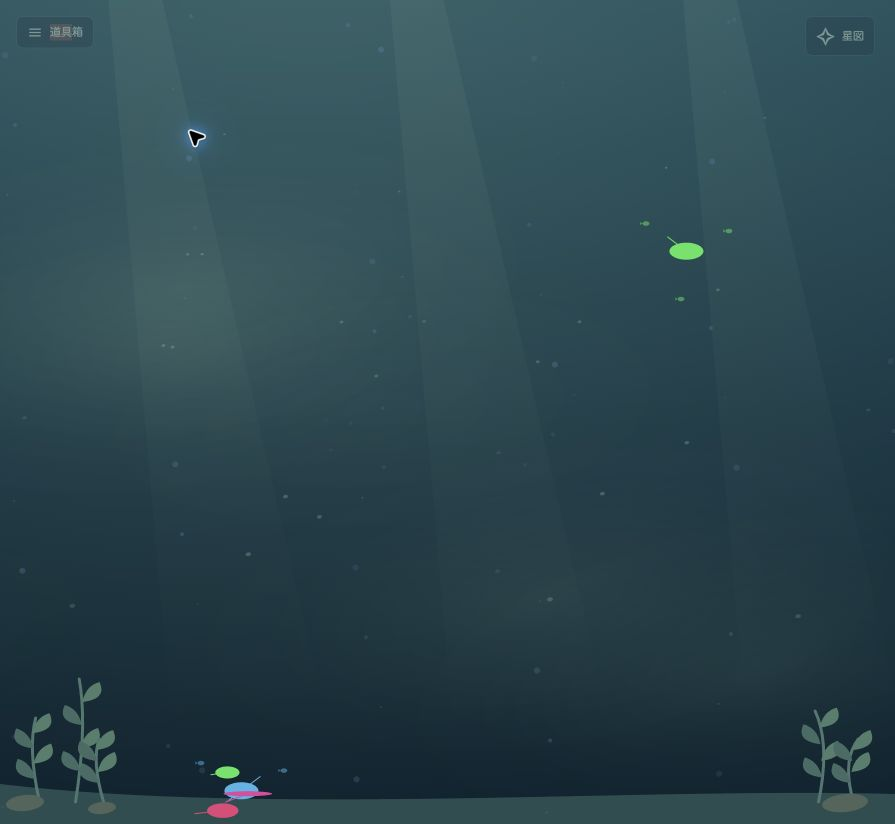

# #16 水流の設計

状態: ホストの実測送受信量による水槽内の潮を実装済み。水槽間の潮は合成データで表示・遷移を確認できる。実機の相手別計測は未実装。

## 何が見えるか

プロセス間の関係は既存のバブルが担当する。水流は水槽を満たす水の動きとして、外との通信の活発さを伝える。

水槽内では、背景の淡い光や浮遊物がゆっくり同じ方向へたなびく。受信時は左側から内側へ、送信時は内側から右側へ漂い、端では薄く消える。左右は表示上の約束で、実際の通信相手の位置ではない。魚を始点・終点にせず、線、矢印、経路ごとの粒列を追加しない。魚の泳ぎや操作には干渉させない。

星図から接近すると、水槽内と同じ潮が背景と一緒に見えてくる。水槽ごとの背景パレットに合わせ、四角い境界や常設の件数表示は作らない。将来の水槽間の潮は、相手まで確認できた通信だけを銀河の間に広がる柔らかな潮として表す。

## 接続と活動を分ける

`network_flows` は接続先の観測であり、活動量の入力には使わない。接続数、ESTABLISHED、listener の存在から水流の強さや動く方向を決めない。

最初の活動量はホストのインターフェースごとの送受信カウンタ差分を使う。[psutil のネットワーク API](https://psutil.io/)では `net_io_counters(pernic=True)` がインターフェース別の累積バイト数を返し、`net_connections` はソケット端点を返す。前者の値を個々の魚や接続先に割り振ることはできない。

ホスト全体の潮には対象インターフェースを明示的に選ぶ。loopback は対象外にし、VPN・bridge・仮想NICを重複して合算しない。自動判定できない構成では対象を指定できるようにする。ホスト合計を接続数で按分して水槽間の通信量に見せない。

水槽間の潮には、相手別の実測カウンタを持つ収集機能が別途必要。OSごとの収集方法、権限、負荷を検証してから追加する。片側しか観測できない通信、NATやアドレス重複で相手が曖昧な通信は外部との潮にとどめる。両側で同じ転送を観測しても二重加算しない。

## 実装したデータ契約

`Snapshot.network_activity` は省略・null可。測定範囲 `scope: interface`、収集方式 `source: psutil`、対象 `interface`、観測期間 `interval_seconds`、差分 `sent_bytes` / `received_bytes`、取得状態 `status` を持つ。`peer` は未実装で、現在のvalidatorは受け入れない。

`status` は `ready`（実測）、`warming`（基準値取得）、`unavailable`（対象なし・停止）、`ambiguous`（自動選択の候補が複数）、`denied`（権限不足）、`unsupported`（未対応）、`error`（取得失敗）。`ready` 以外には期間・バイト数を入れない。`ready` では期間は正の有限値、バイト数は非負の安全な整数とし、片方向の不明はnull、両方向不明は不可。

- agent の monotonic clock で差分と観測期間を計算する。別ホストの時計を引き算しない。
- 初回、カウンタの減少、インターフェース変更、再起動、収集方式変更は基準値を取り直す。その区間をゼロ通信として送らない。
- 実測ゼロ、未対応、権限不足、収集失敗を区別する。片方向だけ不明な場合も勝手にゼロにしない。
- 集約サーバは従来どおり受信時刻で freshness を判定する。クライアントは同じ sequence の再受信で活動を延長しない。
- peer を追加する場合はホスト・boot・PID・create_time と観測区間を保持し、古いプロセスや別の起動セッションへ結び直さない。

## 描画の責務

活動量の状態と平滑化は Tank ごとに持ち、背景 provider に送受信それぞれの強さと遷移状態を渡す。背景パレットやカメラとは独立させる。

強さは上限のある対数的な変換を通し、3.5秒の時定数でなじませる。転送量の増大を粒の高速化へ直結させず、光と浮遊物の濃さに反映する。取得が止まったら最後の活動が流れ続けないように静かに消す。新しいsequenceの到着から5秒（長い観測区間では3区間分、最大30秒）で活動を失効させ、サーバのStale / Offlineも優先する。測定ゼロなら通常の穏やかな背景へ戻る。

一時停止、動きを減らす設定、Canvasへの切替を尊重する。背景の雰囲気と通信由来の変化を区別できるよう、通信表示を切ると活動による変化だけが消える。操作や説明は既存の設定窓に収める。

## 受け入れ条件

1. 接続を維持したまま無通信にすると、活動による潮が収まる。listenerだけでは発生しない。
2. 受信・送信・双方向の合成データで、水槽全体のゆるやかな動きの違いが分かる。魚を結ぶ線は増えない。
3. バーストを与えても速い粒や細かなガクつきが出ない。魚とバブルの読みやすさを維持する。
4. 欠測、カウンタリセット、再接続で流量が跳ねず、未計測を実測ゼロとして扱わない。
5. 複数水槽で活動量が混ざらない。水槽への接近中も潮の方向が突然切り替わらず、矩形の端が出ない。
6. WebGPU / Canvas、小画面、動きを減らす設定で実際の表示を確認する。

## 再現と検証

agent の `--network-interface en0` または環境変数 `AQUARIUM_NETWORK_INTERFACE=en0` で観測対象を1つ指定できる。省略時は稼働中の非loopback候補から既知のVPN・bridge等を除外し、1つに絞れる場合のみ使う。機種固有の仮想NICをすべて識別できる保証はないため、複雑な構成では明示指定する。

実プロセスを送信せずに確認する場合は `python main.py server --port 8765` と `python tools/demo_multiverse.py --hosts 3 --tides cycle` を使う。16秒ごとに受信・送信・双方向・無通信・未計測が切り替わり、水槽ごとに位相がずれる。`--tides receive/send/both/idle/missing` では状態を固定できる。ブラウザの `?renderer=canvas` で代替描画を指定できる。

PythonテストではNIC選択、差分、リセット、権限不足、復帰、wire形式を検証。Nodeテストでは無通信、重複取得による延命防止、欠測のフェード、水槽の分離、30/60/120Hz、一時停止、動きを減らす設定、浮遊物の分布を検証する。

検証（2026-10-23）: Python 107件、Node 42件成功。ChromeのWebGPU / Canvasで60fps、390px幅の設定窓、通信表示切替、一時停止、背景切替と星図往復を確認。macOSの実NIC `en0` で初回基準値→差分計測への移行を確認。以下は双方向の合成データを使ったCanvas表示。

## 水槽間のシミュレーション

`python tools/demo_multiverse.py --hosts 3 --between-tanks` で、こもれび → しおさい → よいまちの通信を合成する。`V` で星図を開くと、銀河の間に輪郭のない光の潮が渡る。16秒ごとに弱い通信（32KiB/s）、強い通信（8MiB/s）、逆向き（2MiB/s）、双方向（各4MiB/s）、無通信へ切り替わる。潮の幅と濃さが3.5秒の時定数で追従し、速度は変わらない。銀河へ入ると、その相手がいる方向の水槽内の潮へ切り替わる。

合成転送は `Snapshot.simulated_transfers` に明記し、`source: fixture` の場合だけ受け入れる。最大32相手、相手のhost/boot、期間、送受信のバイト差分を持つ。各組は片側だけが報告し、両側の合成NIC合計も一致させる。実ホストのNIC合計やソケット一覧から水槽間の通信を推測しない。ブラウザもfixture同士・同じ集約先・一致するbootだけを結び、重複した組は1本にする。欠測でフェードし、再起動した相手には引き継がない。

画面外の水槽へ架空の線を伸ばさず、同じ星図ページ内の最大6水槽を対象とする。合成転送があるページは、水槽内へ入ったあともそのページの取得を継続し、相手から届く潮を更新する。実機の相手別計測が揃うまでは、実ホスト間に通信中を示す潮を描かない。

シミュレーション追加後の検証: Python 118件、Node 47件成功。合成データの転送量とホスト合計の一致、実agentデータでの拒否、重複抑止、相手の再起動・欠測、潮の幅と方向を検証。Chrome WebGPUでは星図の水槽間描画を60fpsで確認した。
